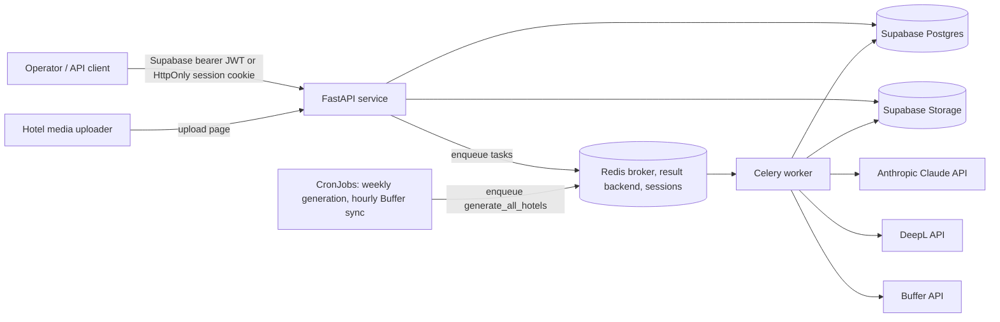

# Architecture

## Purpose and scope

`aipostit` is a FastAPI application for managing hotel profiles and media, generating Turkish social posts, translating drafts, reviewing them, and submitting approved posts to Buffer for scheduling. PostgreSQL and object storage are provided by Supabase; Redis and Celery handle background work.

People see the product as **aipostit**, and everything else is named aipostit too: the app, its image (`ghcr.io/easypeasyops/hotel_social_posts/aipostit`), its release tags (`aipostit/vX.Y.Z`), its deploy values, its cookies, its Celery app and its access logger (`aipostit.access`). It was called postitglobal until v0.3.8: the `postitglobal/v*` tags, releases and images are its history.

This document describes the implementation in the repository today. It distinguishes implemented behavior from planned or incomplete behavior.

## System context

## Runtime components

| Component | Responsibility | Implementation |
|---|---|---|
| HTTP API | Hotel, asset, and draft endpoints; upload page; job triggers; liveness endpoint | FastAPI application in `app/main.py` |
| Operator UI | Sign-in, hotel dashboard/profile management, and scoped upload-link creation | FastAPI routes and Jinja templates |
| Persistence | Hotel profiles, assets metadata, drafts, translations, and publish log | Supabase Postgres via the Supabase Python client |
| Media storage | Uploaded hotel images and videos; profile photos (`avatars/`) | Supabase Storage bucket named `hotel-assets` (private) |
| Published media | Copies of the images a post carries, at URLs that don't expire | Supabase Storage bucket named `published-media` (public reads) |
| Background work | Asset status updates, generation, translation, publishing | Celery tasks in `app/jobs/tasks.py` |
| Broker/backend and web sessions | Celery queue/task results and operator session records | Redis, configured by `REDIS_URL` |
| Text generation | Turkish post drafts | Anthropic Claude; model selected by hotel tier |
| Translation | Draft translations | DeepL API Free endpoint; enabled languages vary by tier |
| Social scheduling | Queue approved Turkish drafts | Buffer API |
| Deployment | The platform's Kubernetes cluster (since plan 5.9; Railway before): the API, the worker, Redis and two CronJobs (weekly generation, hourly Buffer sync), from the platform's service chart | `Dockerfile`; `deploy/` |

The API and worker are separate processes but use the same source image and environment. The container's default command starts the API; the worker needs its own service/start command. The API also requires Redis for browser sessions.

**The image** (plan 5.3, as shortly's): two stages, so the runtime holds only the virtualenv from `uv.lock` and `app/`; base images pinned by digest and bumped by Dependabot (`.github/dependabot.yaml`, with the Python dependencies and the Actions); for now the runtime stage also upgrades `zlib1g` to Debian's security fix, which the pinned base image lacks, and drops that once a newer digest carries it; runs as UID 10001, not root, with code and dependencies owned by root and only readable; no pip, ensurepip or apt (nothing installs at run time); exposes 8000 (app) and 9100 (metrics); `uvicorn` is PID 1 in exec form, so SIGTERM reaches it and requests in flight get 20 s to finish. The worker runs the same image with `celery -A app.jobs.tasks.celery_app worker`.

## Operator authentication and dashboard

1. Operators sign in with email/password or **Continue with Google** (when `GOOGLE_SIGN_IN` is true) through Supabase Auth. Operator accounts are provisioned in Supabase; the application does not implement sign-up.
2. The API stores access and refresh tokens in Redis behind a random, HttpOnly cookie (`aipostit_session`). The cookie is `SameSite=Strict`, has a seven-day lifetime, and uses `Secure` by default; local HTTP development can set `SESSION_COOKIE_SECURE=false`.
3. **Forgot password?** on the sign-in page opens `/forgot-password`, which asks Supabase for a recovery email and answers the same whether or not the address has an account. Password-recovery requests direct Supabase's email link to `/auth/callback`. The callback page receives tokens in the URL fragment, removes the fragment from browser history, and posts them to `/auth/callback/recovery`; any other link type (an old email sign-in link, say) gets an error and a way back to sign-in.
4. Recovery tokens are saved in a separate, 15-minute Redis record accessible only through a dedicated reset cookie; the reset form changes the password using the recovery session, then removes the temporary record.
5. Dashboard routes and the existing JSON API accept either a Supabase bearer token or the browser session cookie, and only for an operator: an account whose Supabase `app_metadata.role` is `operator` (`require_operator` in `app/auth/dependencies.py`; any other signed-in account gets 403). Users can't change their own `app_metadata`, so an operator is only ever made by hand in Supabase. Sign-in checks access before it creates a session (`landing_page`): an operator starts at `/dashboard/hotels`, hotel staff at `/hotel` (see "Hotel staff" below), and a password, email-link or Google sign-in with neither is refused (403, "This account doesn't have access"), and a password reset without it changes the password but signs nobody in. The role is read from Supabase on each request (`get_user`), so granting or removing it takes effect at once. Session access tokens are refreshed near expiry.
6. The dashboard supports listing, creating, and editing hotel profiles, displaying hotel asset records, and generating and reviewing drafts: **Generate new drafts** (`POST /dashboard/hotels/{hotel_id}/generate`) queues that hotel's generation task now, as the weekly CronJob does for every hotel; a hotel's page lists its drafts in `pending_review` as post previews (below), with Approve and publish and Reject (optional feedback) buttons, and its ten latest decided drafts with their outcome (`approved`, `scheduled`, `published`, `failed`). The buttons post to `/dashboard/hotels/{hotel_id}/drafts/{draft_id}/approve` and `/reject`, which act only on a draft of that hotel still in `pending_review`; a second click changes nothing. **Edit text** (`…/edit`) saves a pending draft's edited Turkish text and **Choose images** (`…/images`) its photos (see Review and publishing). Files and drafts can be deleted there too (`…/assets/{asset_id}/delete`, `…/drafts/{draft_id}/delete`, each after a browser confirmation): a file with its Storage object; a draft that isn't at Buffer (`pending_review`, `rejected`, `failed`) with its translations and publish log (cascade) and the image copies a publish attempt made in `published-media`. An approved, scheduled or published draft can't be deleted (409): its post is at Buffer, which the row's deletion wouldn't recall.
7. **Continue with Google** (`app/auth/google.py`) uses Supabase's Google provider with PKCE. `GET /login/google` keeps a fresh PKCE verifier in an HttpOnly cookie (`aipostit_oauth_verifier`, path `/auth/callback/google`, 10 minutes, `SameSite=Lax`, since the browser comes back from Google) and redirects to Supabase's `/auth/v1/authorize` with its S256 challenge. `GET /auth/callback/google?code=…` exchanges the code and the verifier for a session (`exchange_code_for_session`). A code without this browser's verifier is refused, which stops a login-CSRF code from someone else. Only existing accounts get in: Supabase's "Allow new users to sign up" is off, so an unknown Google address comes back with `error_code=signup_disabled` ("There's no aipostit account for that Google address"), and the operator check applies as for a password. Supabase links Google to an existing account with the same verified email. The response is a short page that moves on to `/dashboard/hotels`, because the `SameSite=Strict` session cookie would not travel on a redirect in a chain that began at Google.
8. The sign-in pages (`/login`, `/forgot-password`, `/auth/callback`, `/reset-password`) share `app/templates/auth/_layout.html`, in the customer layer of the design system (the logo's iris purple on sand, Figtree). Password fields have a Show/Hide toggle, and the reset form checks the length, strength and match as the password is typed (the server still enforces at least 8 characters and the match). They load no third-party script, since they handle passwords and the callback's URL carries tokens: their styles are inline CSS rather than the Tailwind CDN the dashboard uses.
9. `GET /dashboard/profile` shows the operator's own account: full name, email and role. The name is Supabase `user_metadata.full_name` (`app/account.py`), which Google sign-in fills too. `POST /dashboard/profile` saves it (`save_full_name`: spaces collapsed, 1 to 100 characters, else a 422 that keeps what was typed) with the service role's `auth.admin.update_user_by_id`; Supabase merges `user_metadata`, so its other keys stay. The page's password button posts the account's own email to `/forgot-password`, the reset flow above. An account without a name (one made before sign-up asked for it, or an operator made by hand) is asked for one first: the dashboard's router dependency `operator_page`, and `staff_page` for `/hotel`, send any page load (GET) other than the profile to `/dashboard/profile?name=required` (or `/hotel/profile?name=required`), which says why. Saving the name there goes on to `/dashboard/hotels` (or `/hotel`). Form posts aren't held back, so nothing in flight is lost. Both profile pages also take a **profile photo** (`app/profile_photo.py`, one set of routes for both areas): `POST /account/photo` takes a JPEG, PNG or WebP of up to 5 MB (anything else goes back with `?photo=invalid`), turns it upright, crops its middle to a 256 px square WebP (Pillow) and stores it at `avatars/{user_id}.webp` in `hotel-assets`, replacing the last one; `user_metadata.photo_version` is set to the upload's time. `GET /account/photo` serves the account its own photo only (404 without one), cached by the browser, since the menu's link carries the version (`/account/photo?v=…`) and changes with each upload. `POST /account/photo/remove` deletes the object and clears the version. An account that is neither operator nor staff gets 403. The menu and the profile show the uploaded photo, else Google's `avatar_url`, else the initials.
10. Every signed-in page (`base.html`, and `staff/base.html` for hotel staff) has a user menu at the right of its top bar, with **Sign out** inside it. `require_operator` and `require_staff_member` put what it shows on `request.state.account` (`menu` in `app/account.py`): the account's photo if Google sign-in gave one (`user_metadata.avatar_url`), else its initials, and "Welcome, {first name}" ("Hoş geldin, …" for staff; only the photo or initials at phone width). The name falls back to the email's local part while the account has none. It opens on the full name and email (for staff, also the hotel and role), **Profile**, **Ekip** for a hotel admin, and **Sign out**. It is a `
`, so it opens without JavaScript; `app/static/menu.js` closes it on Esc (focus goes back to its button), a click outside it, or tabbing out.
11. Session records are server-side in Redis; Redis availability is therefore required for operator sign-in and authenticated browser requests.

Hotel-level isolation is not implemented for operator accounts: any operator can access all hotel records because the backend uses its Supabase service-role client.

## Hotel staff

Hotel staff are Supabase accounts tied to one hotel by a row in `hotel_members` (`user_id`, `hotel_id`, `email`; migration `003`), with a `role` (migration `004`): `hotel_admin`, `content_moderator` or `content_creator`. They have no operator role, so they never reach `/dashboard` or the operator API (403). Their pages, under `/hotel` (`app/staff.py`, in Turkish and in the customer layer like the upload page), resolve the hotel and role from the signed-in account (`require_staff_member`, `member_of` in `app/hotels/staff.py`), never from the URL. Every role sees the files and the pending drafts with their previews, and uploads. Changing or deciding content (every `POST /hotel/files/…` and `POST /hotel/drafts/…` route below) takes a hotel admin or a content moderator (`require_moderator`, `can_moderate`): a content creator gets 403 and the pages show them none of those buttons. The role is read on each request, so a change applies at once.

- `GET /hotel` lists the hotel's uploaded files with their category and status. Each photo a post can carry (`image_choices`) shows as its thumbnail (`thumbnail_of`: the worker's small copy, or the photo itself until there is one), through a signed link made in one Storage request with the full-size ones (`photo_links`, valid an hour); clicking it opens the full-size photo in a `<dialog>` on the page. Other files, such as videos, show their file type instead. Under **Düzenle**, staff rename a file (`POST /hotel/files/{asset_id}/edit`: the name keeps its extension, which decides whether a post can carry it, and the stored object keeps its path; an empty name or one with `/` is refused, 422) and change its category, or delete it (`…/delete`, as the dashboard's delete: the object and the row). A file a draft has taken to Buffer (`sent_asset_ids`: named by an approved, scheduled or published draft) offers neither and refuses both (409), so the record of what went out stays true; pending drafts that named a deleted file go on without it. Another hotel's file is a 404.
- `GET /hotel/upload` redirects to `/upload/{slug}#token=…` with a fresh 24-hour upload capability for that hotel, so staff use the same upload page and API as an upload link.
- `GET /hotel/drafts` lists the hotel's drafts in `pending_review` as post previews (below). **Onayla ve yayınla** (`POST /hotel/drafts/{draft_id}/approve`) and **Reddet** with optional feedback (`…/reject`) act as the dashboard's buttons do: approval queues the publish task, a draft that is no longer pending stays as it is, and another hotel's draft is a 404. **Metni düzenle** (`…/edit`) and **Görselleri seç** (`…/images`) edit the text and photos as the dashboard's **Edit text** and **Choose images** do. **Sil** (`…/delete`, after a confirmation) deletes the draft as the dashboard's **Delete** does; a draft at Buffer can't be deleted (409). `GET /hotel` shows how many drafts wait.

- `GET /hotel/staff`, for the hotel admin only (`require_hotel_admin`; any other role gets 403 and `/hotel` doesn't link it), manages the hotel's team as the dashboard's "Hotel staff" section does: the members with their roles, the hotel's invites (as on the dashboard, in Turkish, with **İptal et**), the same one invite form (`POST /hotel/staff/invite`, `create_invite`, in Turkish, with the admin's email as `invited_by_email`), a role change (`POST /hotel/staff/{user_id}/role`) and removal (`…/remove`). Both act only on the hotel's own members, and never on the admin themselves (409), so a hotel can't lose its admin by a slip; an operator can still change anyone's role. An unknown role is a 422.
- `GET /hotel/profile`, for every role, shows the staff member's own account: full name (`user_metadata.full_name`, as for operators), email, hotel and role, in Turkish. `POST /hotel/profile` saves the name and its **Şifre değiştirme bağlantısı gönder** emails the reset link, as on the dashboard's profile.
- `GET /hotel/details`, also for the hotel admin only, edits the hotel's name, location, contact email, description, channels and invite retention (`POST /hotel/details`, through `HotelUpdate` and `update_hotel` as the dashboard does). A blank name, location or contact email, an unknown channel, or a retention that isn't a whole number from 7 to 180, is a 422 that keeps what was typed. The slug, tier and Buffer profiles aren't on the form and stay with operators.

`/hotel` pages get `Cache-Control: no-store`, and a signed-out visit goes to `/login`, as for the dashboard.

Staff make their own accounts from an invite. On a hotel's dashboard page, one form (email, role, days valid, **Send invite**; `POST /dashboard/hotels/{hotel_id}/staff-invite`) records the invite: `create_invite` in `app/hotels/invites.py` inserts its `staff_invites` row (`invited_by_email` the operator's, `expires_at` now plus `valid_days`, 1 to 30, else 422; an unknown role or an email without `@` is a 422 too) and makes its link with `create_recorded_invite_token`. With SMTP set up it emails the link and sets `last_sent_at` and `send_count`; with no SMTP, or a failed send (logged), the row stays pending with no `last_sent_at`. The page says "sent to" or "email not sent" under the form and offers **Copy invite link**, a button that copies the link (the link is never shown as text). Both pages list the hotel's invites, newest first (`list_invites`, on the `(hotel_id, created_at desc)` index): email, role, status, made, expires and who invited. On both pages they come below the form, the pending ones first, the ended ones (accepted, expired, revoked) folded under "Ended invites", with status badges, then the members. The status comes from the row (`invite_status`: accepted if `accepted_at`, revoked if `revoked_at`, expired once `expires_at` has passed, else pending), and a pending invite with no `last_sent_at` is marked "email not sent". Only a pending invite has its link (on its **Copy invite link** button, **Bağlantıyı kopyala** on `/hotel/staff`: a `data-copy` attribute, never shown as text), rebuilt from the row by `create_recorded_invite_token` each time the page renders (the database holds no link). Invites made before they were recorded aren't listed; the pages say so. A pending invite's **Revoke** (`POST /dashboard/hotels/{hotel_id}/invites/{invite_id}/revoke`; on `/hotel/staff`, **İptal et**, `POST /hotel/staff/invites/{invite_id}/revoke`, for the hotel admin, the operator's invites included) is `revoke_invite`: one update setting `revoked_at` and `revoked_by_email` where the id and hotel match and the invite is still pending (not accepted, revoked or expired). Anything else, another hotel's invite included, is left alone, and the page redirects back with the outcome (`?done=revoked`), as Remove and Change do (`?done=removed`, `?done=role`). The link then fails at `/signup` (400). If a sign-up claimed the invite a moment before, the revoke matches nothing and the invite stays accepted. `/hotel/staff` has the same form. Neither page makes the older invites any more; the 7-day cutover after which none of them still works starts when this reaches prod (PR 9 of the spec then drops them). An older invite is `/signup#invite=…` for a role, a capability signed like the upload link (7 days, `app/auth/upload_tokens.py`), whose purpose names the role (`staff_invite_purpose`: `staff-invite` for a hotel admin, the purpose every invite had before roles, so those links still make hotel admins; `staff-invite:content_moderator` and `staff-invite:content_creator` for the others). Several people can use it until it expires, and only rotating `SECRET_KEY` revokes it early. The sign-up page (`app/auth/signup.py`) moves the invite from the URL fragment into its form. An invite can also name one email (`create_token(…, email=…)`, signed with the rest so it can't be changed): the sign-up page shows that address, fixed, and `POST /signup` refuses any other (403), so it works only for the person it was sent to. The form asks for a full name (1 to 100 characters, else 422), saved as `user_metadata.full_name`. `POST /signup` reads the hotel, role and any email from the invite (`read_staff_invite`; an invalid, expired or other-purpose token, or a deleted hotel, makes nothing). It then creates the user with the service role (`auth.admin.create_user`, email confirmed, since the invite is what vouches for the person; Supabase's own sign-up stays off), inserts the `hotel_members` row with that role (or deletes the user again if that fails), signs the account in and goes to `/hotel`. An email that already has an account is refused (409); an operator adds an existing account to a hotel by SQL (RUNBOOK). `POST /signup` also takes a recorded invite (`staff-invite-record`, `create_recorded_invite_token` and `read_recorded_invite`), which carries the hotel and a `staff_invites` row's id and expires with the row; nothing issues one yet (spec `docs/product/spec-staff-invite-tracking.md`, PR 3). Only such a token reads `staff_invites`, so the older invites work where migration `006` isn't applied. The row gives the email and role (`pending_invite` in `app/hotels/invites.py`): a missing row, another hotel's, or one accepted, revoked or expired makes nothing (400, as an invalid invite), and any other address is a 403. Before the account is made, `claim_invite` sets `accepted_at` in one update that matches only a pending row, so of two sign-ups racing on one invite only one goes on; if the account or its `hotel_members` row then can't be made, `release_invite` sets it pending again. Invite emails go out in Turkish through `app/mail.py` and the SMTP account (`smtplib`, STARTTLS, 15 s timeout). The same section lists the hotel's staff (email, date joined, role). **Change** (`POST /dashboard/hotels/{hotel_id}/staff/{user_id}/role`) sets another role, applied on the account's next request; an unknown role is a 422; **Remove** (`POST /dashboard/hotels/{hotel_id}/staff/{user_id}/remove`, acting only on that hotel's member) deletes the `hotel_members` row. The Supabase account stays, without access, and its open session gets 403 on its next request. The section's forms (invite, Revoke, Change, Remove) work as plain posts; with JavaScript, `app/static/inline.js` posts a form marked `data-inline="staff"` (`data-inline="team"` on `/hotel/staff`, whose redirects carry the outcome the same way) with `fetch` and swaps the section in from the page the server answers with (the redirect's, or the invite form's 200 or 422), so the page doesn't reload or jump, and focus goes to the outcome message (`data-focus`). An answer that isn't a page (a 409 or 422 from a check) shows a short error next to the form. The same script copies a `data-copy` button's link, says "Copied ✓", and where the clipboard can't be used shows the link selected to copy by hand.

## Request and job flows

### Hotel media intake

1. An operator generates a hotel upload link from the dashboard. The link carries a signed capability in the URL fragment; the token is scoped to one hotel and expires after 24 hours.
2. The hotel opens `/upload/{hotel_slug}`. The browser reads the fragment token and removes it from the visible URL. The fragment is not sent in the initial HTTP request.
3. The browser requests a signed upload URL from `POST /api/v1/upload-capabilities/{hotel_id}/upload-url`, passing the capability as a bearer token.
4. The API creates an `assets` row with `pending` status and returns an upload URL for Supabase Storage.
5. The client uploads directly to Storage, then calls `POST /api/v1/upload-capabilities/{hotel_id}/assets/{asset_id}/confirm` with the same capability.
6. The API verifies that the asset belongs to the capability's hotel, changes it to `processing`, and enqueues `process_asset`.
7. The task (`process_asset_task`) makes each JPEG or PNG a thumbnail (`app/assets/thumbnails.py`, Pillow): turned upright as its EXIF orientation says, at most 480 px on each side, WebP (transparency kept), uploaded to `thumbnails/{hotel_id}/{asset_id}.webp` in `hotel-assets`, a folder of its own so no uploaded file's name can clash. Its path goes in `assets.thumbnail_path` (migration `005`) and the asset becomes `ready`. A photo Pillow can't open is `failed` without a retry, since retrying can't mend the file; a Storage or database error is retried as before. Other files, such as videos, become `ready` with no thumbnail; they are not inspected or transcoded. Deleting an asset removes its thumbnail with it. Photos uploaded before thumbnails existed get theirs from `backfill_thumbnails_task` (`tasks.backfill_thumbnails`), run by hand (RUNBOOK): it makes them for `ready` photos without a `thumbnail_path`, skipping (and logging) any it can't read rather than failing them.

The operator asset API remains bearer/session protected. The upload capability can only create and confirm uploads; it cannot list or delete assets. Treat upload links as passwords until their 24-hour expiry. The page response uses `Cache-Control: no-store` and `Referrer-Policy: no-referrer`.

### Generation and translation

1. A caller with the cron secret posts to `/internal/jobs/generate`, which enqueues generation for each hotel. `/internal/jobs/generate/{hotel_id}` enqueues one hotel's job.
2. The generation task loads the hotel and up to ten most recent `ready` assets.
3. It builds a Turkish prompt and selects the draft model for `standard`, or the premium model for `growth` and `premium`.
4. Claude returns JSON posts. Each post is stored as a `content_drafts` row in `pending_review`.
5. A translation task is enqueued for each draft. Standard tier translates to English; growth and premium translate to English, German, Russian, and Arabic.
6. Translation rows are upserted by `(draft_id, language)`.

The translation task tolerates individual language failures by logging and skipping those translations, so the task can finish while a draft has incomplete translations.

### Review and publishing

1. An operator reads drafts in `pending_review`, on the hotel's dashboard page or through `/api/v1/content`, and the hotel's own staff read theirs at `/hotel/drafts`; either may decide.
   Both pages show each draft as a **post preview** (`app/templates/preview/`): the images the post will carry, chosen as publishing chooses them (`postable_images`: ready JPEG and PNG images, in the draft's order, at most 10), with the Turkish text, in the look of the draft's network. Each network has its own look: Instagram a swipeable square carousel; Facebook the text above the images, in its grid of up to four with the rest counted as +N; TikTok photo mode, a vertical frame the images swipe through, with the caption over it; Google Business Profile the first image only, then the text. A channel outside `SocialChannel` gets a plain card. `hotel-assets` is private, so the images come through signed Storage links (`app/content/preview.py`), one request per page, valid for an hour. If Storage fails the preview shows no images and the text can still be reviewed.
2. Approving a draft changes its status to `approved` and enqueues a publish task. Rejecting changes its status to `rejected` and optionally stores feedback. Before deciding, either reviewer can edit a draft's Turkish text (`edit_draft_text`): the text is trimmed, empty text is refused (422), and only a draft still in `pending_review` changes, so an edit can't alter a post already at Buffer. A saved edit queues the translation task again, which overwrites the draft's translations from the new text. Its photos can be chosen too (`set_draft_images`): the picker offers the hotel's photos a post can carry (`image_choices`: ready JPEG and PNG files), with thumbnails (`thumbnail_of`) signed in the same Storage request as the previews, which show the full-size photos; the ticked ones are saved as `asset_ids` in the order numbered (unnumbered ones after), at most 10. A photo that isn't one of those choices is refused (422), and as with text only a pending draft changes; no translation is involved.
3. The publish task sends the Turkish body to the Buffer channel configured for the draft's network (`hotels.buffer_profiles`), through Buffer's GraphQL API (`createPost` at `https://api.buffer.com`, mode `shareNext`: the top of that channel's queue; for Instagram with `metadata.instagram` `{type: post, shouldShareToFeed: true}`, without which Buffer refuses the post), with the draft's images: each ready JPEG or PNG among its `asset_ids`, in order and at most 10 (Instagram's carousel limit), copied from `hotel-assets` into the public `published-media` bucket (`<hotel>/<draft>/<asset>.<ext>`). Buffer fetches media when the post goes out, possibly days later, so it gets those permanent public URLs, not signed ones that would expire. Instagram refuses text-only posts: an Instagram draft without a ready image fails before Buffer is called. Videos are not sent yet. The task then writes a `publish_log` row with Buffer's post ID and marks the draft `scheduled`. Buffer answers HTTP 200 even when it refuses a post; the refusal (`MutationError` or the `errors` array) raises `BufferError`, so nothing is logged and the task retries.
4. The hourly `sync-buffer` CronJob queues `tasks.sync_buffer_posts`, which asks Buffer (the `post` query) about each `publish_log` row still `scheduled`. A post Buffer sent (`sent`) marks the row and its draft `published`, the row's `published_at` being Buffer's `sentAt`; one it couldn't send (`error`, a disconnected channel say) marks both `failed` and logs Buffer's message. Any other status (`scheduled`, `sending`, ...) waits for the next run. A post Buffer won't return (deleted in Buffer's app, say) is logged and skipped, so it doesn't hold up the others; the rate limit (429) ends the run.

Publishing currently sends one Turkish post per draft; translations are not sent to Buffer. Buffer's outcome comes back by that hourly poll, not a webhook: a draft shows `published` up to an hour after its post goes out.

## API surface

All API route prefixes below are registered in `app/main.py`.

| Route | Authentication | Purpose |
|---|---|---|
| `GET/POST /signup` | A staff invite (form field from the link's fragment) | Hotel staff sign-up |
| `GET /hotel`, `GET /hotel/upload`, `GET /hotel/drafts` | Session or bearer JWT of hotel staff (`hotel_members`), any role | The staff member's own hotel: its files, the upload page with a fresh upload link, and its pending drafts |
| `GET /hotel/staff`, `POST /hotel/staff/invite`, `POST /hotel/staff/{user_id}/role`, `…/remove` | As above, role `hotel_admin` | The hotel's team: invites for one address and role, role changes and removal of its other members |
| `GET/POST /hotel/details` | As above, role `hotel_admin` | The hotel's name, location, contact email, description, channels and invite retention |
| `POST /hotel/files/{asset_id}/edit`, `…/delete`, `POST /hotel/drafts/{draft_id}/approve`, `…/reject`, `…/edit`, `…/images`, `…/delete` | As above, role `hotel_admin` or `content_moderator` | Change the hotel's files, and edit, approve, reject or delete its drafts |
| `GET /healthz` | None | Liveness (`{"status":"ok"}`): the process answers. Checks no dependency |
| `GET /readyz` | None | Readiness: `200 {"status":"ready"}` when Redis answers a ping within 2 s, else `503 not ready: Redis`. Supabase and the providers are not checked |
| `GET /login`, `POST /login`, `GET/POST /forgot-password`, `GET /auth/callback`, `POST /auth/callback/recovery`, `GET/POST /reset-password`, `GET /login/google`, `GET /auth/callback/google`, `POST /logout` | Public auth entry/callback; short-lived recovery cookie for password update; session for logout | Password or Google sign-in, password recovery, sign-out |
| `GET /` | None | The home page (`templates/home.html`, Turkish, for hotels; no script). A browser already signed in goes on to its own pages, as a new session would: an operator to `/dashboard/hotels`, hotel staff to `/hotel` |
| `/dashboard/*` | Operator session or Supabase bearer JWT; operator role | Hotel list, hotel create/edit/detail, and scoped upload-link creation |
| `GET /upload/{hotel_slug}` | None; upload API requires capability | Render hotel media upload page |
| `GET /static/*` | None | Brand images: the logo and the browser-tab icons, from `app/static` |
| `/api/v1/hotels` | Supabase bearer JWT or operator session; operator role | List, create, retrieve, update, and delete hotel profiles |
| `/api/v1/assets` | Supabase bearer JWT or operator session; operator role | List assets, create operator upload URLs, confirm uploads, and delete assets |
| `/api/v1/upload-capabilities/{hotel_id}/*` | 24-hour hotel-scoped signed capability | Create upload URL and confirm an asset upload |
| `/api/v1/content` | Supabase bearer JWT or operator session; operator role | List/retrieve drafts, approve/reject drafts, and retrieve translations |
| `/internal/jobs/generate` | `X-Cron-Secret` | Enqueue generation for all hotels |
| `/internal/jobs/generate/{hotel_id}` | `X-Cron-Secret` | Enqueue generation for one hotel |
| `/docs` | None, debug mode only | Interactive OpenAPI docs; disabled when `DEBUG` is false |

## Data model

The initial schema is defined in `supabase/migrations/001_initial_schema.sql`; `002_published_media_bucket.sql` adds the public `published-media` Storage bucket; `003_hotel_members.sql` adds `hotel_members`; `004_hotel_member_roles.sql` adds its `role`; `005_asset_thumbnails.sql` adds `assets.thumbnail_path`; `006_staff_invites.sql` adds `staff_invites` and `hotels.invite_retention_days`, which no released version uses yet (staff invite tracking, `docs/product/spec-staff-invite-tracking.md`).

- `hotels`: hotel profile, subscription tier, channels, contact, and Buffer channel IDs per network (`buffer_profiles`, named for the REST API's profiles).
- `assets`: hotel-owned metadata, Storage path, category, and processing state.
- `content_drafts`: Turkish source text, channel, review/publishing status, and associated asset IDs.
- `content_translations`: translated text keyed uniquely by draft and language.
- `hotel_members`: hotel staff accounts, one hotel each (`user_id` primary key, cascading from `auth.users` and `hotels`), with a `role` checked to `hotel_admin`, `content_moderator` or `content_creator` (default `hotel_admin`, so staff from before roles, and rows an older image inserts, keep what they could do). Row-level security is on with no policies, so only the service-role key reads or writes it.
- `staff_invites`: one row per staff invite, cascading from `hotels`: the invitee's `email` (required, lower case), the `role` it gives (checked as `hotel_members.role`), `valid_days` (1 to 30, default 7), `invited_by_email`, `created_at`, `expires_at`, `last_sent_at` (null when no email went out) and `send_count`, and `accepted_at` or `revoked_at` (never both) with `revoked_by_email`. Its status (pending, accepted, expired, revoked) is derived from those columns, not stored. Indexed by hotel and creation time, for a hotel's list, and by when the invite ended (the earliest of `accepted_at`, `revoked_at` and `expires_at`), for the purge. Row-level security is on with no policies, as for `hotel_members`.
- `hotels.invite_retention_days`: how many days an ended invite's row is kept (default 90, checked 7 to 180, and by `HotelUpdate`). The operator sets it on the dashboard's hotel edit form, the hotel admin on `/hotel/details`; a form that doesn't send it leaves it as it is. `tasks.purge_ended_invites` (`purge_ended_invites` in `app/hotels/invites.py`) deletes, per hotel, the invites that ended (the earliest of `accepted_at`, `revoked_at` and `expires_at`) more than its retention ago. PostgREST can't filter on `least(…)`, so it runs three deletes on the `hotel_id` index: `accepted_at` before the cutoff, `revoked_at` before it, and, with neither set, `expires_at` before it. These are the same rows, since accepting and revoking come before expiry and never both. Pending invites are never deleted. It logs one line per run (the total and the number of hotels) and a line per hotel that lost rows, never an email. A hotel whose delete fails is logged, the rest are purged, and then the task fails. It has no retries: the deletes are idempotent and the next run catches up. Nothing schedules it yet (spec PR 8); RUNBOOK says how to run it by hand.
- `publish_log`: Buffer post ID (`buffer_update_id`, named for the REST API's updates) and scheduling status.

Assets, drafts, translations, and publish-log records use foreign keys with cascading deletion from their owning hotel or draft. `hotels` and `content_drafts` have `updated_at` triggers. The migration does not define row-level security policies, indexes beyond primary/unique constraints, or Storage bucket policies.

## In the cluster (plan 5.9)

Since 5.9 aipostit runs on the platform's Kubernetes cluster, rendered by the platform's service chart (1.2.1 or later) from `deploy/service/values.yaml` and `deploy/envs/<env>.yaml`, in the namespaces `aipostit-staging` and `aipostit-prod`:

| Piece | What the values ask the chart for |
|---|---|
| API | The release image, 2 replicas in prod and 1 in staging (no autoscaling), probes on `/healthz` and `/readyz`, behind the Gateway at `aipostit.localhost` and `staging.aipostit.localhost` |
| Worker | `workers.worker`: the same image running `celery … worker --concurrency=2`, 120 s to finish its tasks on SIGTERM |
| Redis | `redis.enabled`: the chart's in-namespace Redis 8, its URL templated into `REDIS_URL`, reachable only from this app's pods |
| Weekly generation | `cronJobs.generate-weekly`, prod only (staging shares prod's Supabase, so a second run would duplicate every hotel's drafts): Mondays 06:00 UTC, `celery … call tasks.generate_all_hotels` queues the task and exits. It replaced Railway's cron, which called the HTTP endpoint |
| Buffer sync | `cronJobs.sync-buffer`, prod only (staging shares prod's rows and the one Buffer quota): hourly at :15, `celery … call tasks.sync_buffer_posts` queues the task and exits |
| Keys | `secretEnv.store: aipostit`: the platform's store for this app, loaded by hand from `.env`; each secret variable reads one key of `aipostit-env` |
| Alerts | `monitoring.rules.alerts` in `deploy/envs/prod.yaml`, prod only: one PrometheusRule whose rules aggregate by namespace, so they cover staging too (a second copy would double every alert). The platform's Alertmanager routes them to Slack (RUNBOOK, Alerts) |
| Network | Ingress: the app port from the Gateway, metrics from Prometheus. Egress: DNS, the app's Redis, and ports 443 and 587 (Gmail's SMTP) outside the private ranges (Supabase and the providers can't be named in a NetworkPolicy). The SMTP keys reach the pods only where `config.inviteEmail` is "true" |

Staging and prod share the keys and the Supabase project (decided for plan 5): staging's runs are real. The kind cluster's front door is plain HTTP on localhost, so both set `SESSION_COOKIE_SECURE=false`. CI renders both environments with the chart and validates them (`ci.yml`, deploy values).

The cluster runs the platform's `main`, not the commit `platform.lock` names: Argo CD takes the namespace setup (`deploy/app-namespace`) from platform `main`, and the platform's own config (Alertmanager's routes, the Gateway, the secret store) is applied from `main` too. The lock pins CI's reusable workflows only; the chart is pinned by digest in the platform's `apps/aipostit/envs/<env>.yaml` and in `ci.yml`.

Argo CD deploys the image digest in `deploy/envs/<env>.yaml` on main. Releasing and deploying take one merge each (RUNBOOK, Cut a release): a merge that changes the version tags it (`tag-release.yml`); the release (`release.yml`) opens the staging PR with the new digest, which merges itself when `ci` is green; **Promote to prod** (`promote.yml`) opens the prod PR with staging's digest, which waits for a person. The tag and the PRs are made by the release GitHub App's token, since what `GITHUB_TOKEN` makes starts no other workflow.

## Configuration and trust boundaries

Settings are loaded from environment variables (and `.env` for local use) by `app/config.py`. Required values are:

| Variable | Use |
|---|---|
| `SECRET_KEY` | Internal token signing configuration |
| `PUBLIC_BASE_URL` | Optional; public app origin used for Supabase password-recovery and Google sign-in redirects (defaults to `http://localhost:8000`) |
| `SUPABASE_URL` | Supabase project endpoint |
| `SUPABASE_ANON_KEY` | Publishable/anon Supabase key |
| `SUPABASE_SERVICE_ROLE_KEY` | Server-side Supabase operations; bypasses RLS |
| `ANTHROPIC_API_KEY` | Claude API |
| `DEEPL_API_KEY` | DeepL API |
| `BUFFER_ACCESS_TOKEN` | Buffer GraphQL API key (Buffer → Settings → API), sent as `Authorization: Bearer`. A legacy REST OAuth token doesn't work |
| `CRON_SECRET` | Protects internal job-trigger routes |
| `METRICS_PORT` | Optional; `9100` by default: the port `/metrics` is served on. `0` serves none |
| `LOG_LEVEL` | Optional; `INFO` by default |
| `LOG_JSON` | Optional; `true` by default: one JSON object per log line. `false` for plain lines when reading locally |
| `REDIS_URL` | Optional; defaults to local Redis URL |
| `SESSION_COOKIE_SECURE` | Optional; defaults to true, set false only for local HTTP development |
| `GOOGLE_SIGN_IN` | Optional; defaults to false. True shows **Continue with Google** and opens `/login/google`; set it only once Supabase's Google provider is set up (RUNBOOK). Deploy value `config.googleSignIn` |
| `SMTP_USERNAME`, `SMTP_PASSWORD`, `SMTP_HOST`, `SMTP_PORT`, `MAIL_FROM` | Optional. The SMTP account staff invite emails go through: Gmail's (`smtp.gmail.com`, 587 with STARTTLS) by default, with the account's address and a Google app password (RUNBOOK). Without `SMTP_PASSWORD` the app sends no email and offers invite links only. `MAIL_FROM` defaults to `SMTP_USERNAME` |

`CLAUDE_DRAFT_MODEL` and `CLAUDE_PREMIUM_MODEL` are optional overrides. API bearer tokens and browser-session access tokens are validated through Supabase Auth. Browser refresh tokens are stored in Redis, not in the cookie. The database dependency uses the service-role key for application queries, so route authentication verifies an identity and the operator role but does not enforce hotel-level tenancy; all operators share the same application data access. Upload capabilities are HMAC-signed with `SECRET_KEY`, scoped to one hotel and one purpose, and expire after 24 hours.

## Reliability and current design limits

- Celery uses JSON task/result serialization and `Europe/Istanbul` timezone. Tasks retry with finite retry limits and fixed countdowns.
- Route handlers and their dependencies are plain `def`, not `async def`: the Supabase, Redis and Celery clients are synchronous, so FastAPI runs those handlers in its thread pool, and one slow Supabase call doesn't stall other requests (`tests/test_concurrency.py`). Only code that awaits stays `async` (the DeepL calls, the middleware, `lifespan`, and the probes `/healthz`, `/health` and `/readyz`).
- Probes (plan 5.3): `/healthz` is liveness only. `/readyz` checks Redis, which every operator request needs and which runs beside the app; an unready pod leaves the Service until Redis is back. It doesn't check Supabase or the providers: they are outside the cluster, and an outage there would take every pod out at once with nothing to fail over to. Both are `async` and answered on the event loop, and the Redis ping runs on its own one-thread limiter, so probes never queue behind request work.
- Operator sessions and authenticated browser API requests depend on Redis; there is no session failover.
- Single points (accepted for now): one Redis per environment holds both the Celery broker and the operator sessions (the chart runs one Redis pod), so losing it stops logins and jobs together (`AipostitRedisDown` pages). One worker per environment, with no probe: the chart's workers have none, so a Celery process that hangs without exiting keeps its pod Running and `AipostitWorkerDown` quiet; tasks just wait in Redis. RUNBOOK, "Jobs are not progressing", says how to tell.
- A task retry is not equivalent to an idempotent external operation. For example, Buffer may schedule a post even if the subsequent database write fails; retrying could schedule a duplicate.
- Asset processing makes photo thumbnails, which also checks a photo opens; it doesn't inspect videos. Photos uploaded before thumbnails existed have none until `tasks.backfill_thumbnails` is run; until then the pages load them full size as their thumbnail.
- A hotel-generation task creates drafts before queuing translation. A retry after partial completion may create duplicate drafts.
- Translation failures can leave a partial set of translation rows without failing the overall task.
- No periodic Celery beat schedule is configured here. Weekly generation is the cluster's `generate-weekly` CronJob, which queues the task directly; `POST /internal/jobs/generate` does the same by hand. The hourly Buffer sync is the `sync-buffer` CronJob.
- Supabase schema migrations and Storage bucket setup are external provisioning steps; the app does not apply migrations on startup.
- Authentication has no MFA or role management UI. Operators are made by hand in Supabase; hotel staff sign up from an invite link (or are added by SQL). A recorded invite can be revoked on its own; invites from before recording (multi-use links included) can't, and run out on their own within 7 days of the cutover, until PR 9 of the spec drops them. Password recovery is supported for existing users only; there is no email-link sign-in.
- Logs (plan 5.3): the API and the worker write one JSON object per line to stdout (`app/observability.py`): `ts`, `level`, `logger`, `msg`, and the fields a call adds (a failed translation's `draft_id`, `language`, `error`). Every request gets a request ID, kept from a plain `X-Request-ID` header or generated, echoed in the response and on every line the request logs; one access line per request names its route template (`/api/v1/hotels/{hotel_id}`), never the raw path. Probes are logged at DEBUG.
- Metrics (plan 5.3): the API serves Prometheus metrics on their own port, `METRICS_PORT` (9100), not the public one: `http_requests_total{method, route, status}` and `http_request_duration_seconds{method, route}`, shortly's names, so the platform's SLO rules and dashboards read both apps alike. Routes are templates, never raw paths. The worker exports no metrics yet. The deploy values have Prometheus scrape the API (`monitoring.enabled`). Alert rules (RUNBOOK, Alerts) cover the API from its metrics and the worker, Redis and Jobs from kube-state-metrics; they are threshold alerts for low traffic, not SLOs yet: SLO burn-rate rules wait until the app has run long enough to set objectives (the platform Prometheus keeps 10 days). Prod's release ships them for both environments (`monitoring.clusterWide`, one release per cluster), and the platform's Alertmanager posts each environment's to its Slack channel.

## Source map

- Application setup and route registration: `app/main.py`
- Operator dashboard, sessions, and upload capabilities: `app/dashboard.py`, `app/auth/`; the account's name for the profile pages: `app/account.py`; in-place form updates and copy buttons: `app/static/inline.js`; the user menu and profile photo: `app/account.py`, `app/static/menu.js`, `app/profile_photo.py`
- Settings and Supabase client: `app/config.py`, `app/database.py`
- API routers and services: `app/hotels/`, `app/assets/`, `app/content/`
- Authentication and cron authorization: `app/auth/dependencies.py`
- Celery tasks: `app/jobs/tasks.py`
- Provider integrations: `app/generation/`, `app/translation/`, `app/publishing/`, `app/mail.py` (SMTP)
- Database schema and Storage buckets: `supabase/migrations/`
- Dependencies and tool settings: `pyproject.toml`, `uv.lock`, `.python-version`
- Tests and checks: `tests/`, `scripts/smoke.sh`, `scripts/ci-scope.sh`, the repo's `.github/workflows/ci.yml`
- Deployment configuration: `Dockerfile`, `.dockerignore`, `docker-compose.yml`, `deploy/` (the service chart's values); dependency bumps: the repo's `.github/dependabot.yaml`

## Related documentation

- Operational procedures: [Runbook](./RUNBOOK.md)
