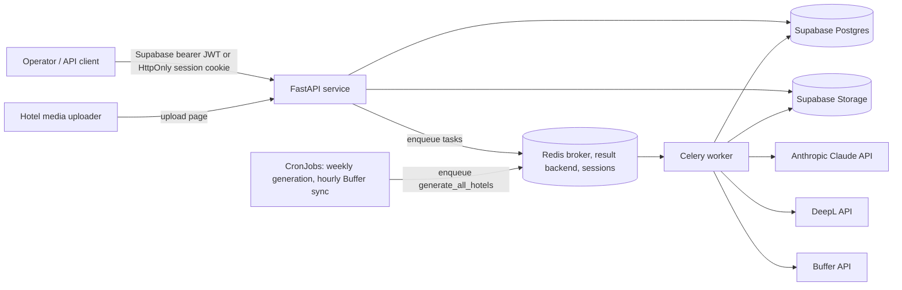

# Architecture

## Purpose and scope

`postitglobal` is a FastAPI application for managing hotel profiles and media, generating Turkish social posts, translating drafts, reviewing them, and submitting approved posts to Buffer for scheduling. PostgreSQL and object storage are provided by Supabase; Redis and Celery handle background work.

This document describes the implementation in the repository today. It distinguishes implemented behavior from planned or incomplete behavior.

## System context

## Runtime components

| Component | Responsibility | Implementation |
|---|---|---|
| HTTP API | Hotel, asset, and draft endpoints; upload page; job triggers; liveness endpoint | FastAPI application in `app/main.py` |
| Operator UI | Sign-in, hotel dashboard/profile management, and scoped upload-link creation | FastAPI routes and Jinja templates |
| Persistence | Hotel profiles, assets metadata, drafts, translations, and publish log | Supabase Postgres via the Supabase Python client |
| Media storage | Uploaded hotel images and videos | Supabase Storage bucket named `hotel-assets` (private) |
| Published media | Copies of the images a post carries, at URLs that don't expire | Supabase Storage bucket named `published-media` (public reads) |
| Background work | Asset status updates, generation, translation, publishing | Celery tasks in `app/jobs/tasks.py` |
| Broker/backend and web sessions | Celery queue/task results and operator session records | Redis, configured by `REDIS_URL` |
| Text generation | Turkish post drafts | Anthropic Claude; model selected by hotel tier |
| Translation | Draft translations | DeepL API Free endpoint; enabled languages vary by tier |
| Social scheduling | Queue approved Turkish drafts | Buffer API |
| Deployment | The platform's Kubernetes cluster (since plan 5.9; Railway before): the API, the worker, Redis and two CronJobs (weekly generation, hourly Buffer sync), from the platform's service chart | `Dockerfile`; `deploy/` |

The API and worker are separate processes but use the same source image and environment. The container's default command starts the API; the worker needs its own service/start command. The API also requires Redis for browser sessions.

**The image** (plan 5.3, as shortly's): two stages, so the runtime holds only the virtualenv from `uv.lock` and `app/`; base images pinned by digest and bumped by Dependabot (`.github/dependabot.yaml`, with the Python dependencies and the Actions); runs as UID 10001, not root, with code and dependencies owned by root and only readable; no pip or ensurepip; exposes 8000 (app) and 9100 (metrics); `uvicorn` is PID 1 in exec form, so SIGTERM reaches it and requests in flight get 20 s to finish. The worker runs the same image with `celery -A app.jobs.tasks.celery_app worker`.

## Operator authentication and dashboard

1. Operators sign in with email/password or request an email magic link through Supabase Auth. Operator accounts are provisioned in Supabase; the application does not implement sign-up.
2. The API stores access and refresh tokens in Redis behind a random, HttpOnly cookie (`postitglobal_session`). The cookie is `SameSite=Strict`, has a seven-day lifetime, and uses `Secure` by default; local HTTP development can set `SESSION_COOKIE_SECURE=false`.
3. Magic-link and password-recovery requests direct Supabase email links to `/auth/callback`. The callback page receives tokens in the URL fragment, removes the fragment from browser history, and posts tokens to the server.
4. Magic-link tokens are validated and saved in Redis as an operator session. Recovery tokens are saved in a separate, 15-minute Redis record accessible only through a dedicated reset cookie; the reset form changes the password using the recovery session, then removes the temporary record.
5. Dashboard routes and the existing JSON API accept either a Supabase bearer token or the browser session cookie. Session access tokens are refreshed near expiry.
6. The dashboard supports listing, creating, and editing hotel profiles, displaying hotel asset records, and generating and reviewing drafts: **Generate new drafts** (`POST /dashboard/hotels/{hotel_id}/generate`) queues that hotel's generation task now, as the weekly CronJob does for every hotel; a hotel's page lists its drafts in `pending_review` (text, network, images), with Approve and publish and Reject (optional feedback) buttons, and its ten latest decided drafts with their outcome (`approved`, `scheduled`, `published`, `failed`). The buttons post to `/dashboard/hotels/{hotel_id}/drafts/{draft_id}/approve` and `/reject`, which act only on a draft of that hotel still in `pending_review`; a second click changes nothing. Files and drafts can be deleted there too (`…/assets/{asset_id}/delete`, `…/drafts/{draft_id}/delete`, each after a browser confirmation): a file with its Storage object; a draft that isn't at Buffer (`pending_review`, `rejected`, `failed`) with its translations and publish log (cascade) and the image copies a publish attempt made in `published-media`. An approved, scheduled or published draft can't be deleted (409): its post is at Buffer, which the row's deletion wouldn't recall.
7. The sign-in pages (`/login`, `/auth/callback`, `/reset-password`) share `app/templates/auth/_layout.html`, in the customer layer of the design system (lagoon and sand, Figtree). They load no third-party script, since they handle passwords and the callback's URL carries tokens: their styles are inline CSS rather than the Tailwind CDN the dashboard uses.
8. Session records are server-side in Redis; Redis availability is therefore required for operator sign-in and authenticated browser requests.

Hotel-level isolation is not yet implemented for operator accounts: any authenticated operator can access all hotel records because the backend uses its Supabase service-role client.

## Request and job flows

### Hotel media intake

1. An operator generates a hotel upload link from the dashboard. The link carries a signed capability in the URL fragment; the token is scoped to one hotel and expires after 24 hours.
2. The hotel opens `/upload/{hotel_slug}`. The browser reads the fragment token and removes it from the visible URL. The fragment is not sent in the initial HTTP request.
3. The browser requests a signed upload URL from `POST /api/v1/upload-capabilities/{hotel_id}/upload-url`, passing the capability as a bearer token.
4. The API creates an `assets` row with `pending` status and returns an upload URL for Supabase Storage.
5. The client uploads directly to Storage, then calls `POST /api/v1/upload-capabilities/{hotel_id}/assets/{asset_id}/confirm` with the same capability.
6. The API verifies that the asset belongs to the capability's hotel, changes it to `processing`, and enqueues `process_asset`.
7. The current task marks the asset `ready`; it does not resize, inspect, or transcode media.

The operator asset API remains bearer/session protected. The upload capability can only create and confirm uploads; it cannot list or delete assets. Treat upload links as passwords until their 24-hour expiry. The page response uses `Cache-Control: no-store` and `Referrer-Policy: no-referrer`.

### Generation and translation

1. A caller with the cron secret posts to `/internal/jobs/generate`, which enqueues generation for each hotel. `/internal/jobs/generate/{hotel_id}` enqueues one hotel's job.
2. The generation task loads the hotel and up to ten most recent `ready` assets.
3. It builds a Turkish prompt and selects the draft model for `standard`, or the premium model for `growth` and `premium`.
4. Claude returns JSON posts. Each post is stored as a `content_drafts` row in `pending_review`.
5. A translation task is enqueued for each draft. Standard tier translates to English; growth and premium translate to English, German, Russian, and Arabic.
6. Translation rows are upserted by `(draft_id, language)`.

The translation task tolerates individual language failures by logging and skipping those translations, so the task can finish while a draft has incomplete translations.

### Review and publishing

1. An authenticated operator reads drafts in `pending_review`, on the hotel's dashboard page or through `/api/v1/content`.
2. Approving a draft changes its status to `approved` and enqueues a publish task. Rejecting changes its status to `rejected` and optionally stores feedback.
3. The publish task sends the Turkish body to the Buffer channel configured for the draft's network (`hotels.buffer_profiles`), through Buffer's GraphQL API (`createPost` at `https://api.buffer.com`, mode `shareNext`: the top of that channel's queue; for Instagram with `metadata.instagram` `{type: post, shouldShareToFeed: true}`, without which Buffer refuses the post), with the draft's images: each ready JPEG or PNG among its `asset_ids`, in order and at most 10 (Instagram's carousel limit), copied from `hotel-assets` into the public `published-media` bucket (`<hotel>/<draft>/<asset>.<ext>`). Buffer fetches media when the post goes out, possibly days later, so it gets those permanent public URLs, not signed ones that would expire. Instagram refuses text-only posts: an Instagram draft without a ready image fails before Buffer is called. Videos are not sent yet. The task then writes a `publish_log` row with Buffer's post ID and marks the draft `scheduled`. Buffer answers HTTP 200 even when it refuses a post; the refusal (`MutationError` or the `errors` array) raises `BufferError`, so nothing is logged and the task retries.
4. The hourly `sync-buffer` CronJob queues `tasks.sync_buffer_posts`, which asks Buffer (the `post` query) about each `publish_log` row still `scheduled`. A post Buffer sent (`sent`) marks the row and its draft `published`, the row's `published_at` being Buffer's `sentAt`; one it couldn't send (`error`, a disconnected channel say) marks both `failed` and logs Buffer's message. Any other status (`scheduled`, `sending`, ...) waits for the next run. A post Buffer won't return (deleted in Buffer's app, say) is logged and skipped, so it doesn't hold up the others; the rate limit (429) ends the run.

Publishing currently sends one Turkish post per draft; translations are not sent to Buffer. Buffer's outcome comes back by that hourly poll, not a webhook: a draft shows `published` up to an hour after its post goes out.

## API surface

All API route prefixes below are registered in `app/main.py`.

| Route | Authentication | Purpose |
|---|---|---|
| `GET /healthz` | None | Liveness (`{"status":"ok"}`): the process answers. Checks no dependency |
| `GET /readyz` | None | Readiness: `200 {"status":"ready"}` when Redis answers a ping within 2 s, else `503 not ready: Redis`. Supabase and the providers are not checked |
| `GET /login`, `POST /login`, `POST /login/magic-link`, `POST /login/forgot-password`, `GET /auth/callback`, `POST /auth/callback/session`, `POST /auth/callback/recovery`, `GET/POST /reset-password`, `POST /logout` | Public auth entry/callback; short-lived recovery cookie for password update; session for logout | Password or magic-link sign-in, password recovery, sign-out |
| `GET /` | None | Redirects to `/dashboard/hotels` (signed out, on to `/login`) |
| `/dashboard/*` | Operator session or Supabase bearer JWT | Hotel list, hotel create/edit/detail, and scoped upload-link creation |
| `GET /upload/{hotel_slug}` | None; upload API requires capability | Render hotel media upload page |
| `/api/v1/hotels` | Supabase bearer JWT or operator session | List, create, retrieve, update, and delete hotel profiles |
| `/api/v1/assets` | Supabase bearer JWT or operator session | List assets, create operator upload URLs, confirm uploads, and delete assets |
| `/api/v1/upload-capabilities/{hotel_id}/*` | 24-hour hotel-scoped signed capability | Create upload URL and confirm an asset upload |
| `/api/v1/content` | Supabase bearer JWT or operator session | List/retrieve drafts, approve/reject drafts, and retrieve translations |
| `/internal/jobs/generate` | `X-Cron-Secret` | Enqueue generation for all hotels |
| `/internal/jobs/generate/{hotel_id}` | `X-Cron-Secret` | Enqueue generation for one hotel |
| `/docs` | None, debug mode only | Interactive OpenAPI docs; disabled when `DEBUG` is false |

## Data model

The initial schema is defined in `supabase/migrations/001_initial_schema.sql`; `002_published_media_bucket.sql` adds the public `published-media` Storage bucket.

- `hotels`: hotel profile, subscription tier, channels, contact, and Buffer channel IDs per network (`buffer_profiles`, named for the REST API's profiles).
- `assets`: hotel-owned metadata, Storage path, category, and processing state.
- `content_drafts`: Turkish source text, channel, review/publishing status, and associated asset IDs.
- `content_translations`: translated text keyed uniquely by draft and language.
- `publish_log`: Buffer post ID (`buffer_update_id`, named for the REST API's updates) and scheduling status.

Assets, drafts, translations, and publish-log records use foreign keys with cascading deletion from their owning hotel or draft. `hotels` and `content_drafts` have `updated_at` triggers. The migration does not define row-level security policies, indexes beyond primary/unique constraints, or Storage bucket policies.

## In the cluster (plan 5.8)

Since 5.9 postitglobal runs on the platform's Kubernetes cluster, rendered by the platform's service chart (1.2.1 or later) from `deploy/service/values.yaml` and `deploy/envs/<env>.yaml`, in the namespaces `postitglobal-staging` and `postitglobal-prod`:

| Piece | What the values ask the chart for |
|---|---|
| API | The release image, 2 replicas in prod and 1 in staging (no autoscaling), probes on `/healthz` and `/readyz`, behind the Gateway at `postitglobal.localhost` and `staging.postitglobal.localhost` |
| Worker | `workers.worker`: the same image running `celery … worker --concurrency=2`, 120 s to finish its tasks on SIGTERM |
| Redis | `redis.enabled`: the chart's in-namespace Redis 8, its URL templated into `REDIS_URL`, reachable only from this app's pods |
| Weekly generation | `cronJobs.generate-weekly`, prod only (staging shares prod's Supabase, so a second run would duplicate every hotel's drafts): Mondays 06:00 UTC, `celery … call tasks.generate_all_hotels` queues the task and exits. It replaced Railway's cron, which called the HTTP endpoint |
| Buffer sync | `cronJobs.sync-buffer`, prod only (staging shares prod's rows and the one Buffer quota): hourly at :15, `celery … call tasks.sync_buffer_posts` queues the task and exits |
| Keys | `secretEnv.store: postitglobal`: the platform's store for this app, loaded by hand from `.env`; each secret variable reads one key of `postitglobal-env` |
| Network | Ingress: the app port from the Gateway, metrics from Prometheus. Egress: DNS, the app's Redis, and port 443 outside the private ranges (Supabase and the providers can't be named in a NetworkPolicy) |

Staging and prod share the keys and the Supabase project (decided for plan 5): staging's runs are real. The kind cluster's front door is plain HTTP on localhost, so both set `SESSION_COOKIE_SECURE=false`. CI renders both environments with the chart and validates them (`ci.yml`, deploy values).

## Configuration and trust boundaries

Settings are loaded from environment variables (and `.env` for local use) by `app/config.py`. Required values are:

| Variable | Use |
|---|---|
| `SECRET_KEY` | Internal token signing configuration |
| `PUBLIC_BASE_URL` | Optional; public app origin used for Supabase magic-link redirects (defaults to `http://localhost:8000`) |
| `SUPABASE_URL` | Supabase project endpoint |
| `SUPABASE_ANON_KEY` | Publishable/anon Supabase key |
| `SUPABASE_SERVICE_ROLE_KEY` | Server-side Supabase operations; bypasses RLS |
| `ANTHROPIC_API_KEY` | Claude API |
| `DEEPL_API_KEY` | DeepL API |
| `BUFFER_ACCESS_TOKEN` | Buffer GraphQL API key (Buffer → Settings → API), sent as `Authorization: Bearer`. A legacy REST OAuth token doesn't work |
| `CRON_SECRET` | Protects internal job-trigger routes |
| `METRICS_PORT` | Optional; `9100` by default: the port `/metrics` is served on. `0` serves none |
| `LOG_LEVEL` | Optional; `INFO` by default |
| `LOG_JSON` | Optional; `true` by default: one JSON object per log line. `false` for plain lines when reading locally |
| `REDIS_URL` | Optional; defaults to local Redis URL |
| `SESSION_COOKIE_SECURE` | Optional; defaults to true, set false only for local HTTP development |

`CLAUDE_DRAFT_MODEL` and `CLAUDE_PREMIUM_MODEL` are optional overrides. API bearer tokens and browser-session access tokens are validated through Supabase Auth. Browser refresh tokens are stored in Redis, not in the cookie. The database dependency uses the service-role key for application queries, so route authentication verifies an identity but does not itself enforce hotel-level tenancy; all authenticated API users currently share the same application data access. Upload capabilities are HMAC-signed with `SECRET_KEY`, scoped to one hotel and one purpose, and expire after 24 hours.

## Reliability and current design limits

- Celery uses JSON task/result serialization and `Europe/Istanbul` timezone. Tasks retry with finite retry limits and fixed countdowns.
- Route handlers and their dependencies are plain `def`, not `async def`: the Supabase, Redis and Celery clients are synchronous, so FastAPI runs those handlers in its thread pool, and one slow Supabase call doesn't stall other requests (`tests/test_concurrency.py`). Only code that awaits stays `async` (the DeepL calls, the middleware, `lifespan`, and the probes `/healthz`, `/health` and `/readyz`).
- Probes (plan 5.3): `/healthz` is liveness only. `/readyz` checks Redis, which every operator request needs and which runs beside the app; an unready pod leaves the Service until Redis is back. It doesn't check Supabase or the providers: they are outside the cluster, and an outage there would take every pod out at once with nothing to fail over to. Both are `async` and answered on the event loop, and the Redis ping runs on its own one-thread limiter, so probes never queue behind request work.
- Operator sessions and authenticated browser API requests depend on Redis; there is no session failover.
- A task retry is not equivalent to an idempotent external operation. For example, Buffer may schedule a post even if the subsequent database write fails; retrying could schedule a duplicate.
- Asset processing is a placeholder status transition, not media validation or transformation.
- A hotel-generation task creates drafts before queuing translation. A retry after partial completion may create duplicate drafts.
- Translation failures can leave a partial set of translation rows without failing the overall task.
- No periodic Celery beat schedule is configured here. Weekly generation is the cluster's `generate-weekly` CronJob, which queues the task directly; `POST /internal/jobs/generate` does the same by hand. The hourly Buffer sync is the `sync-buffer` CronJob.
- Supabase schema migrations and Storage bucket setup are external provisioning steps; the app does not apply migrations on startup.
- Operator authentication has no sign-up, MFA, or role management UI. Magic links and password recovery are supported for existing users only.
- Logs (plan 5.3): the API and the worker write one JSON object per line to stdout (`app/observability.py`): `ts`, `level`, `logger`, `msg`, and the fields a call adds (a failed translation's `draft_id`, `language`, `error`). Every request gets a request ID, kept from a plain `X-Request-ID` header or generated, echoed in the response and on every line the request logs; one access line per request names its route template (`/api/v1/hotels/{hotel_id}`), never the raw path. Probes are logged at DEBUG.
- Metrics (plan 5.3): the API serves Prometheus metrics on their own port, `METRICS_PORT` (9100), not the public one: `http_requests_total{method, route, status}` and `http_request_duration_seconds{method, route}`, shortly's names, so the platform's SLO rules and dashboards read both apps alike. Routes are templates, never raw paths. The worker exports no metrics yet. The deploy values have Prometheus scrape the API (`monitoring.enabled`); alert rules come once the app has run long enough to set its SLOs.

## Source map

- Application setup and route registration: `app/main.py`
- Operator dashboard, sessions, and upload capabilities: `app/dashboard.py`, `app/auth/`
- Settings and Supabase client: `app/config.py`, `app/database.py`
- API routers and services: `app/hotels/`, `app/assets/`, `app/content/`
- Authentication and cron authorization: `app/auth/dependencies.py`
- Celery tasks: `app/jobs/tasks.py`
- Provider integrations: `app/generation/`, `app/translation/`, `app/publishing/`
- Database schema and Storage buckets: `supabase/migrations/`
- Dependencies and tool settings: `pyproject.toml`, `uv.lock`, `.python-version`
- Tests and checks: `tests/`, `scripts/smoke.sh`, `scripts/ci-scope.sh`, the repo's `.github/workflows/ci.yml`
- Deployment configuration: `Dockerfile`, `.dockerignore`, `docker-compose.yml`, `deploy/` (the service chart's values); dependency bumps: the repo's `.github/dependabot.yaml`

## Related documentation

- Operational procedures: [Runbook](./RUNBOOK.md)
